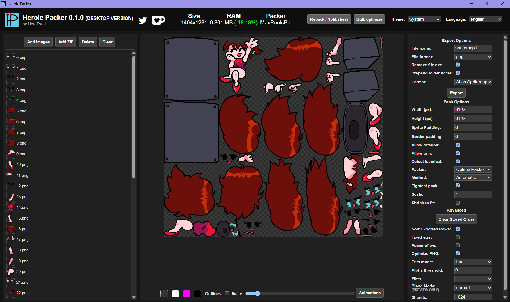

<h1>
	
	Heroic Packer
</h1>


is a tool designed to create and optimize spritesheets and texture atlas.

**Use it at [heroicpacker.heroeyad.dev](https://heroicpacker.heroeyad.dev/) or download the app on [GameBanana!](https://gamebanana.com/tools/24738)**



## Features

**Packing**

- Trimming, rotation and detection of identical sprites
- Several packers (MaxRects, Growing, Ordered and an Optimal mode that tries them all), plus a slower "Tightest pack" search
- Scaling with Lanczos resampling, and "Shrink to fit" to lower the scale until everything fits on one texture
- Padding that matches Adobe Animate, power-of-two and fixed texture sizes
- Optional lossless PNG compression on export

**Repacking existing sheets**

- Load a sheet with its data file and repack it smaller, or split it back into frames
- Bulk optimize: drop a folder or zip of sheets and get every one of them repacked. A sheet is only replaced when the new one is actually smaller
- Repack check: after exporting, every frame is compared with where it should sit, so you can see nothing moved

**Adobe Animate texture atlases**

- Repack `Animation.json` + `spritemap1.json` atlases, with `Animation.json` adjusted for trimmed and scaled sprites
- Convert an atlas to Sparrow frames, one animation per label
- Export any sheet as a texture atlas

**Animations and characters**

- Preview every animation, with per-animation offsets, per-frame offsets, frame reordering and renaming
- Auto-align lines every animation up with the idle pose as a starting point
- Import and export character files for Psych Engine, Codename Engine, Nightmare Vision and V-Slice
- GIF and APNG import: every frame becomes a sprite and keeps its duration

**Everything else**

- Aseprite tags, layers and slices are kept when repacking JSON sheets
- Light and dark themes, a layout for phones, and 9 languages

## Formats

| | |
| --- | --- |
| **Reads** | Sparrow, JSON (hash), JSON (array), Phaser 3, Spine, UIKit, XML, Adobe Animate texture atlas, or a plain grid. Images can be PNG, JPEG, GIF or APNG, loose or in a zip |
| **Writes** | Sparrow, JSON (hash), JSON (array), XML, CSS, Pixi.js, Godot (atlas and tileset), Phaser, Phaser 3, Spine, cocos2d, Unreal Engine Paper2D, UIKit, Unity3D, Egret2D, Adobe Animate texture atlas, or your own [template](#custom-templates) |

## Running it locally

You need [Node.js](https://nodejs.org/) 18 or newer and [Yarn 1](https://classic.yarnpkg.com/).

```sh
git clone https://github.com/HeroEyad/HeroicPacker.git
cd HeroicPacker
yarn
yarn start
```

`yarn start` serves the app at http://127.0.0.1:4000 and reloads on changes. `yarn build` writes a production build to `dist/`, which is plain static files you can host anywhere.


## Custom templates

Choosing the **custom** format lets you write the data file yourself with a [Mustache](https://mustache.github.io/mustache.5.html) template. also the template gets four objects.

### `rects`

One entry per sprite.

| Property | Description |
| --- | --- |
| `name` | Sprite name, as configured by the name options |
| `origName` | Original file name of the sprite |
| `frame` | Position on the texture: `x`, `y`, `w`, `h`, and the half sizes `hw`, `hh` |
| `rotated` | Whether the sprite is rotated on the texture |
| `trimmed` | Whether the sprite was trimmed |
| `spriteSourceSize` | Where the trimmed sprite sits inside its original frame: `x`, `y`, `w`, `h` |
| `sourceSize` | Size of the original frame: `w`, `h`, and `mw`, `mh`, the largest frame of the same animation |
| `frameSize` | The frame as Sparrow sees it: `x`, `y`, `w`, `h` |
| `duration` | Frame duration in milliseconds, when the source had one |
| `hasDuration` | Whether `duration` is set |
| `first`, `last` | True on the first and last entry, handy for separators |

### `config`

| Property | Description |
| --- | --- |
| `imageName`, `imageFile` | Texture name, with and without the extension |
| `imageWidth`, `imageHeight` | Texture size |
| `scale` | Scale the sprites were packed at |
| `spritePadding`, `borderPadding` | Padding between sprites and around the texture |
| `format` | Pixel format, `RGBA8888` or `RGB888` |
| `trimMode` | `trim` or `crop` |
| `base64Export`, `base64Prefix`, `imageData` | The texture as base64, when exported that way |

### `appInfo`

`displayName`, `version` and `url` of Heroic Packer.

### `meta`

Aseprite data carried over from a repacked JSON sheet: `frameTags`, `layers` and `slices`.
Each one of them is a JSON string, so write it with triple braces (`{{{meta.frameTags}}}`).
It is left out when the source had none, and `frameTags` and `slices` are only kept when every source frame is still there in the same order.

### Formatters

Values can be piped through a few helpers: `add`, `subtract`, `multiply`, `divide`, `negate`, `mirror`, `offsetLeft`, `offsetRight` and `escapeName`. 
For example, Sparrow's `frameX` is written as `{{spriteSourceSize.x | negate}}`.

### Example

```mustache
{
	"frames": {
		{{#rects}}
		"{{{name}}}": {
			"frame": { "x": {{frame.x}}, "y": {{frame.y}}, "w": {{frame.w}}, "h": {{frame.h}} },
			"rotated": {{rotated}},
			"trimmed": {{trimmed}},
			"spriteSourceSize": { "x": {{spriteSourceSize.x}}, "y": {{spriteSourceSize.y}}, "w": {{spriteSourceSize.w}}, "h": {{spriteSourceSize.h}} },
			"sourceSize": { "w": {{sourceSize.w}}, "h": {{sourceSize.h}} }
		}{{^last}},{{/last}}
		{{/rects}}
	},
	"meta": {
		"app": "{{{appInfo.url}}}",
		"version": "{{appInfo.version}}",
		"image": "{{config.imageFile}}",
		"size": { "w": {{config.imageWidth}}, "h": {{config.imageHeight}} },
		"scale": {{config.scale}}
	}
}
```

The built-in formats in [src/api/exporters/templates](src/api/exporters/templates) are good starting points.

## Contributing

Bug reports and pull requests are welcome. Before opening a pull request, make sure `npx tsc --noEmit` and `yarn build` both pass.

To add or fix a translation, edit the matching file in [src/client/locale/languages](src/client/locale/languages). `en.json` has every key.

## Credits

Heroic Packer started as a fork of Funkin Packer, which is built on [Free Texture Packer](https://github.com/odrick/free-tex-packer) by Alexander Norinchak.


It uses [React](https://react.dev/), [JSZip](https://stuk.github.io/jszip/), [FileSaver.js](https://github.com/eligrey/FileSaver.js), [mustache.js](https://github.com/janl/mustache.js), [maxrects-packer](https://github.com/soimy/maxrects-packer) and [jSquash](https://github.com/jamsinclair/jSquash).

## License

[MIT](LICENSE.md)
